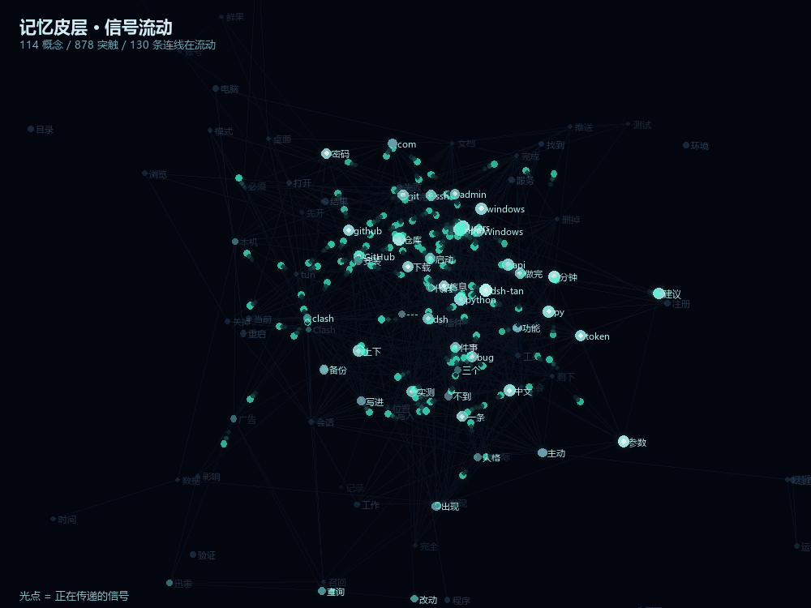

# 更新日志

## v0.4.0 — 2026-11-05

这一版动了底层。之前所有的版本本质都是 grep：句子存进去，查询拆词，
看谁的字重合得多。加 focus、加图谱、加结论层，都是在给 grep 打补丁。

**v0.4.0 换掉了这个模型。** 大脑里存的不是句子，句子是临时拼出来的；
真正存的是**概念**和**概念之间的联系**。

---

### 架构变更

| 之前 | 现在 |
|---|---|
| 一段对话 → 一条记忆 | 一段对话 → 若干**概念**，记忆退化成证据 |
| 查询拆词 → 字符串匹配 | 查询 → 点亮概念 → 沿突触扩散 → 反查记忆 |
| 记忆之间靠相似度连边 | **概念之间**靠 PMI 加权连突触 |
| 分词后直接比 | 先过 IDF，再侧抑制，只留最强的 28 个 |

新增 13 个模块：

```
cortex.py      概念网络 + 激活扩散（核心，11 297 条突触）
aliases.py     中英别名：迅雷 ↔ thunder、广告 ↔ gdt
synonyms.py    893 组同义词：烦 / 不爽 / 恼火 / 火大
sleep.py       夜间重放 + 突触修剪
focusmem.py    工作记忆焦点（短句靠上文补全）
selfmodel.py   知道自己知道什么
digest.py      提醒该归纳了
graph.py       记忆之间的边（共享实体 / 文本相近）
infer.py       关系传递 + 矛盾检测
predict.py     对话序列的转移表
atomic.py      原子写入：add / update / noop
gate.py        写入闸：只留有坐标的和决策类的
focus.py       主题集中度（一条记忆是不是专门在讲这件事）
```

---

### 修掉的 bug

| # | 问题 | 根因 | 影响 |
|---|---|---|---|
| 1 | 插件改动全部空转 | DSH 加载 `node_modules/dsh-tan`，改的是 `D:\dsh-tan\plugin` | 两天里所有插件侧修改一行没跑过 |
| 2 | 检索词恒为空 | `system-prompt/assemble` 在本轮用户消息入库**之前**触发 | 每轮盲搜，只注入最近 3 条 |
| 3 | IDF 方向反了 | 中文 2-gram 切出「络怎」，库里 df = 0，公式给**最大**权重 | 越不存在的词信号越强 |
| 4 | `recall_count` 永远是 0 | `mark_used()` 写好了，没有任何地方调 | 强化和遗忘两个机制全空转 |
| 5 | 纯英文查询全被清空 | `sanitize_query` 里「没有中文就丢弃」 | `Clash` / `gdt` / `node` 一次都没查通过 |
| 6 | 工具注册失败被静默吞掉 | 工具定义字段名是 `execute` 不是 `handler`，`output` 缺 `render` | 试了三次都没成，日志里一个字都没有 |
| 7 | 「好的没问题」照样入库 | 判为 noise 后走 noise 分支，绕过了写入闸 | 垃圾从后门进来 |
| 8 | 建皮层十分钟跑不完 | `db.execute()` 每次 connect+commit+close | 几千条 INSERT 等于几千次 fsync，改单事务后 0.1 秒 |

---

### 新增能力

**联想。** 顺着突触走一跳，注入分成「直接命中」和「（顺带想起）」两段。
实测问「重启」，前三条直接命中，后面自己带出「README 改成下载压缩包」这类关联。

**跨语言。** `thunder` 这个纯英文词，召回的全是中文记忆。

**自我模型。** 问一件没记过的事，不再硬凑：

```
量子计算   → 0 条。「这件事我没印象。我一共记得 360 条，主要是这些主题：…」
迅雷       → 6 条
```

**侧抑制。** 一次只点亮 28 个概念，其余压制。注入从 200-330 token 降到 170-271，命中没变差。

**写入闸。** `/turn` 只留有具体坐标的、或者明确是决策或教训的：

```
丢  我觉得还是要继续优化一下
留  这台机器的 Node 装在 C:\Program Files\nodejs
留  以后都走 TUN 模式，别再切回系统代理
```

**记忆分层自纠正。** 104 条流水账从 L2 事实层降到 L1 情景层（3 天半衰期）。
降级不是删除——被反复召回的会自动拉长半衰期，用得多的自己爬回来。

---

### 可视化

`draw_brain_flow.py` 把真实的概念网络渲成流动式动图：
青色光点沿突触滑行，经过的节点亮起。数据全部来自 `memory.db`。



---

### 参数（都是实测调出来的）

| 项 | 值 | 依据 |
|---|---|---|
| `INJECT_MAX_ITEMS` | 6 | 10 条 512 tok 里 6 条是噪音 |
| `INJECT_LINKED_MAX` | 2 | 给「顺带想起」留名额 |
| `CONCLUSION_BOOST` | 1.6 | 结论是综合的，focus 天生低 |
| `K_WINNERS` | 28 | 皮层也是稀疏的 |
| `INHIBIT_GAMMA` | 1.7 | 侧抑制强度 |
| `SOURCES` / `SIGMA` / `TRAIL` | 1 / 0.10 / 0.13 | 动图波前，单源最清楚 |

---

### 还没做

**预测。** `predict.py` 建了转移表（1279 条规律），但 231 轮对话撑不起统计，
质量一般。要几千轮才靠谱。

**语义。** 现在是 2-gram + 893 组人工同义词。「他有点烦」和「他不高兴」能连上，
「他有点不耐烦」连不上。真语义需要向量模型，本机没有 numpy / onnxruntime / ollama。

**层级。** 概念全在一个平面，没有 V1→V2→IT 那样的逐层抽象。

---

### 现状

```
记忆   360 条（L2 事实 155 / L1 情景 187 / 方法 8 / 教训 5 / 身份 5）
概念  2772 个
突触 14681 条
别名   925 对
预测  1279 条规律
```

数据量到顶了——本机 283 轮对话全导完了。接下来只能靠时间积累。
但可用密度从 29% 提到了接近 100%：原来 360 条里真能用的只有 104 条。


## v0.3.2 — 2026-11-05

这一版只修 bug，不动结构。两个故障都是「改完看起来没反应」的那种，根因不同，但串在一起很像。

### ① 记忆注入与写入全程 401（影响最大）

`api.py` 从 v0.2 起校验 token，只给插件留了一条免 token 通道：

```python
# api.py:215
if (self.headers.get("X-Tan-Source") or "") == "dsh-plugin":
    return True
```

而插件的 `callApi` 只发了 `Content-Type`。于是：

```
/context → 401 → callApi 返回 null → 提示词里没有「我记得的事」
/turn    → 401 → 写入被拒       → 记忆库停在最后一次旧版本写入
```

两处都被 `try/catch` 吞掉，界面上完全安静。表现是「它不记得我」，用户根本无从判断是召回为空、还是请求根本没进来。

实测（同一台机器，同一条 query）：

| 请求 | 结果 |
|---|---|
| `POST /context` 不带头 | `401 {"ok":false,"error":"需要 token"}` |
| `POST /context` 带 `X-Tan-Source: dsh-plugin` | `200`，返回人格 + 记忆 |
| `POST /turn` 不带头 | `401` |
| `POST /turn` 带该头 | `200` |

**修法**（`plugin/lib/index.js`）：`callApi` 统一加 `X-Tan-Source: dsh-plugin`；另外遇到 401 打一次 `console.warn`，不再静默。

> 注意：v0.3.1 里「短问候召回为空」的修法（fallback 到最近 3 条）本身没错，但当时是用带 token 的直连脚本测的，测出来的数据是真的，插件链路却是断的。这一版才真正把链路接通。

### ② 面板「保存」按钮点了像没反应

`plugin/optional/client.js` 里三处叠加：

```js
// 修改前
const startEdit = (m) => setEditing({ id: m.id, text: m.summary || m.content || "" });
...
const saveEdit = async () => {
  ...
  setEditing(null);
  await act("/memory/edit", { id: editing.id, content: t }, "已保存修改");
};
```

1. 编辑框里放的是 `summary`（列表为了紧凑显示摘要），不是正文；
2. 保存只写 `content`，`summary` 不动，而列表优先显示 `summary` → **保存成功了，界面照旧**；
3. `setEditing(null)` 之后再用 `editing.id`，依赖闭包旧值，写法易碎。

**修法**：编辑正文（`m.content || m.summary`）；保存时一并刷新 `summary`（取新内容前 60 字），列表立刻反映修改；先把 `id` 取出来再清状态。

### ③ 装完不生效的坑（文档层面）

DSH 加载的是 profile 下的**实体副本** `~/.dsh/profiles/desktop/node_modules/dsh-tan/lib/`，不是 `plugin/` 源码目录。改完源码必须重装：

```bash
python install.py --panel
# 然后重启 DSH（托盘图标右键 → 退出 → 重新打开）
```

只刷新页面不够——client bundle 只在启动时加载一次。

### ④ 检索词恒为空：用户消息被读成空串

`textOf` 只读了 `event.data.message.content`——那是 assistant 事件的形状；user 事件的正文在 `event.data.content`。于是：

- `/context` 的 query 永远是空 → 每轮注入的是「最近最重要的 N 条」，而不是按你这句话检索
- `/turn` 写入时 `user` 字段永远是空串 → 服务端只能拿 assistant 的回复去做提取

`context.log` 里那些 `q=''` 就是这么来的。

**修法**：两种事件形状都认；`lastUserText` 跳过宿主注入的 `time-context` 时间快照（否则检索词会变成「Time sampled while preparing turn…」），并截断到 200 字。

实测（拿飞书那个 146 轮的会话重放）：

```
修复前  最后一条用户消息 → ""
修复后  最后一条用户消息 → "这个跨会话不会跨工作区"
        turn 146: user="这个跨会话不会跨工作区"  assistant="我先纠正自己的判断…"
```

### 升级方式

```bash
git pull
python install.py --panel
# 重启 DSH
```

### 验证清单

- `~/.dsh/tan/context.log` 出现新的 `q='...' -> N 条/M tok` 行（说明插件在调 `/context` 且通过鉴权）
- 面板「记忆」页点编辑，框里是完整正文而不是摘要
- 改完点保存，列表那一行立刻变化
- 新开一个会话说「我是谁」，回复里能带出记得的事

---

## v0.3.1

- fix: 短问候召回为空时给最近的记忆（看起来像「不记得」的根因）
- docs: 语义检索改用零依赖的实体共现方案
- docs: 加 ROADMAP —— 从「记得住」到「懂你」的四步路径

## v0.3.0

- 迁移到 `D:\dsh-tan`，包名统一为 `dsh-tan`，数据目录 `~/.dsh/tan/`
- 控制台六页（概览 / 记忆 / 人格 / 参数 / 未闭合 / 可视化）
- 备份单文件格式 `.tanbak`，支持导出导入

## 2026-11-05 · 让它像个大脑（而不是带记忆的数据库）

### 修掉的三个致命问题

1. **插件改动全部空转**。DSH 加载 `~/.dsh/profiles/desktop/node_modules/dsh-tan`，
   而我改的是 `D:\dsh-tan\plugin`。两天里所有插件侧修改（过滤、去重、工具、兜底）
   一行都没跑过。加了 `sync-plugin.cmd`，改完必须同步再重启。

2. **检索词恒为空**。`system-prompt/assemble` 在本轮用户消息入库**之前**触发，
   插件去 events 里找最后一条用户消息永远找不到，于是每轮都是空查询、只注入最近 3 条。
   现在拿不到就沿用上一轮我的发言兜底，并在日志打印 `q=...` 便于确认。

3. **IDF 方向反了**。中文 2-gram 会切出「络怎」「么走」这种跨词边界碎片，
   它们在库里 df=0，而 `log(1 + N/(1+0))` 给出**最大**权重——
   越不存在的词信号越强，把真正的关键词压死。现在 df=0 直接给 0 并剔除。

### 新能力

- **记忆图谱**（`hippocampus/graph.py`）：按共享实体 + 文本相近连边，
  268 节点 / 455 边，平均度 3.4。新记忆入库自动连边，每天维护全量重建。
- **联想召回**：顺着边走一跳，注入分成「直接命中」和「（顺带想起）」两段。
  实测问「重启」，前三条直接命中，后面自己带出「README 改成下载压缩包」这类关联。
- **结论层**：12 条提炼过的知识（环境、网络、偏好、业务、项目教训、检索方法），
  带 `CONCLUSION_BOOST = 1.6` 权重，压在原始碎片之上。
- **纯相关度排序**：废掉「身份→方法→事实→情景」的固定装桶。
  那条顺序让一条无关的 L3 方法记忆永远排第一。

### 参数（都是实测调出来的）

| 项 | 值 | 依据 |
|---|---|---|
| `INJECT_MAX_ITEMS` | 6 | 10 条 512 tok 里有 6 条噪音，砍到 6 条是 211-350 tok |
| `INJECT_LINKED_MAX` | 2 | 给「顺带想起」留名额，否则直接命中把位置占满 |
| `CONCLUSION_BOOST` | 1.6 | 结论是综合的，focus 天生低，不加权永远被碎片压着 |
| 建图相似度下限 | 0.10 | 中文 3-gram 的 Jaccard 天然偏低 |
| 建图边权下限 | 0.08 | 再低就是噪声，连上反而干扰联想 |

## 2026-11-05 下午 · 换底层模型：从「句子库」到「概念网络」

### 为什么要推翻

上午那版本质还是 grep：句子存进去，查询拆词，看谁的字重合得多。
加了 focus、图谱、结论层，都是在给 grep 打补丁。

大脑里存的不是句子。句子是临时拼出来的。真正存的是**概念**和**概念之间的联系**。

### 新结构（`hippocampus/cortex.py`）

```
concepts  2115 个概念节点
synapses 11250 条突触（PMI 加权）
traces   10293 条「概念 → 记忆」线索
```

- 概念 = 实体 ∪ 跨 3 条以上重复出现的中文 2-gram（这样「迅雷」才进得来，
  光靠正则实体提取会漏）
- 突触用 PMI 而不是原始共现次数：`Clash ↔ OneDrive` 共现 5 次，但那只是
  因为同一条记忆里都提过，PMI 会把这类偶然共现压掉
- 检索 = 激活扩散：查询词点亮概念 → 沿突触走两跳（每跳 ×0.45）→ 反查记忆

### 性能坑

第一版 build 跑了十分钟没出来，原因是 `db.execute()` 每次 connect+commit+close，
几千条 INSERT 就是几千次 fsync。改成单事务 `executemany` 后：**0.1 秒**。

### 效果

| 查询 | 之前 | 之后 |
|---|---|---|
| 迅雷 | 512 tok，噪音多 | **176 tok，三条全对** |
| 网络怎么走 | 召不出结论 | **第一条就是 Clash TUN 配置结论** |
| 密码 | 命中用户问句 | **第一条是经营主体 + 密码清单位置** |
| 重启 | 命中 | 三条全对 |

### 还没做

新记忆入库后皮层不是实时的，靠每日维护全量重建（0.1 秒，够用）。
真要实时可以在 `/turn` 后增量补突触，但现在没必要。

## 2026-11-05 · 补上大脑缺的另外两个机制

上午做完「概念网络 + 激活扩散」之后，对照大脑还差两块。

### ① 睡眠（`hippocampus/sleep.py`）

人睡觉时海马体会把白天的片段高速重放，跟皮层一起激活。
一起激活过的连接变强，从没走过的剪掉。库里的记忆原本是等权的：
说过一句和说过十遍一样重，天天用的路径和从没用过的一样粗。

三个动作：
- **重放** 60 轮，按「召回次数 + 新近度」加权采样，Hebbian 强化 ×1.04
- **修剪** 权重 < 0.6 的突触删掉（11250 → 10686）
- **合并** —— **默认关掉了**。实测会把「本机网络走 Clash TUN」这条结论并掉，
  之后问「网络」直接召不出来。结论、身份、方法、教训四层现在受保护，
  阈值也从 5.0 提到 9.0。收益远小于风险，等有更好的判据再开。

### ② 工作记忆（`hippocampus/focusmem.py`）

人聊天是连续的：「迅雷广告弄一下」→「再关掉开机自启」→「那个呢」。
第三句单看指不出来，但在场的人知道。程序原本每轮独立检索，做不到。

- 最近被点亮的概念进焦点，15 分钟半衰期衰减
- 查询短于 4 个字时，把焦点拼进查询
- **只收 freq>=4 的概念**：否则「第一」「公事」「和结」这类切词碎片会占满焦点

### ③ 概念激活也按 IDF 加权

「记忆」「系统」「dsh」这种遍地都是的概念，点亮它等于没点亮。
现在初始激活 = 1/(1+log(freq))，让「迅雷」「gdt」这种专门的词说话。

### ④ 身份保底归零

`INJECT_IDENTITY_QUOTA = 0`。以前任何查询的前两位都是两条性格偏好，
问「迅雷」也先告诉你「喜欢可爱轻松的语气」——那不是记忆，那是复读。
身份记忆现在正常参与排序，只在该被想起时出现。
